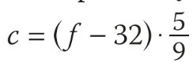
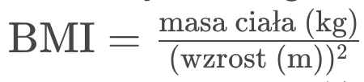

# 315-Python

### Zadania do samodzielnego opracowania do sprawdzianu

1. Napisz program, który przeliczy wielkość podaną w bajtach na bity.

2. Przygotuj program przeliczajacy temperaturę ze skali Fahrenheita na Celsjusza (zapytaj o temperaturę). wg wzoru 
  
4. Przygotuj program sprawdzający warunek trójkąta po podaniu długości boków a, b, c
   
6. Napisz program, który wartość prędkości podaną w m/s zapisze w km/h. Wartość powinna być wyznaczona z dokładnością do części całkowitych.
   
7. Napisz program, który obliczy pole powierzchni trapezu dla podanych długości podstaw oraz wysokości trapezu.
   
9. Napisz program, który wczyta trzy liczby całkowite i sprawdzi, czy były podane w porządku niemalejącym. Program powinien zwrócić odpowiedź „TAK” lub „NIE”.

10. Przygotuj program przeliczający PLN na Euro i Euro na PLN przy kursie 4.22. (zapytaj o walutę i o kwotę)

11. Napisz program, który dla podanego wzrostu (w centymetrach) i wagi (w kilogramach) obliczy wskaźnik masy ciała (BMI).
Uwaga: Przyjmij, że użytkownik wprowadza liczby całkowite, wg wzoru 

12. Napisz program, który po wczytaniu liczby trzycyfrowej wyświetli jej cyfry w odwróconym porządku.

13. Napisz program, który dla liczb a, b, c i d obliczy i wyświetli sumę wartości bezwzględnych różnic |a-b|+|b-a|+|c-d| Program powinien się posługiwać wyłącznie instrukcjami if oraz dodawaniem i odejmowaniem.

14. Napisz program wyznaczający wszystkie dzielniki liczby podanej przez użytkownika.

15. Napisz program sprawdzający czy podana liczba jest liczbą pierwszą.

16. Napisz program obliczający silnię liczby podanej przez użytkownika (5! = 1 * 2 * 3 * 4 * 5).

17. Liczba 362 881 ma tę własność, że przy dzieleniu przez 2, 3, 4, 5, 6, 7, 8, 9 daje resztę 1. Znajdź najmniejszą liczbę o tej własności.

18. Napisz program obliczający średnią z dowolnej ilości liczb podanych przez użytkownika (zakończ pobieranie liczb po wpisaniu 0)
